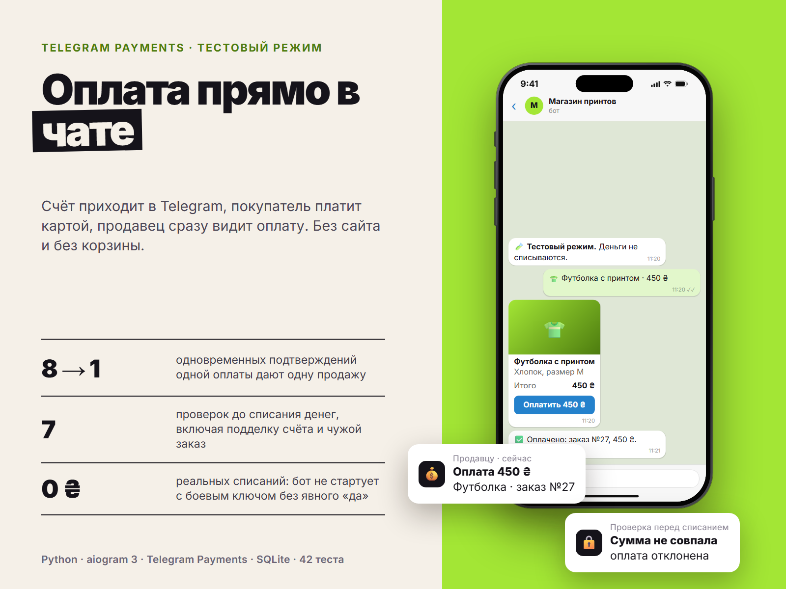

# Payments Demo Bot

Приём оплаты прямо в Telegram-боте через Telegram Payments: покупатель выбирает товар или услугу, получает счёт в чате и платит картой, не выходя из Telegram. Проект работает в **тестовом режиме провайдера**: деньги не списываются, весь путь оплаты проходится по-настоящему.



## Возможности

- Каталог из `catalog.json`: товары с остатком и услуги без ограничения количества
- Счёт (`sendInvoice`) с телефоном покупателя; после оплаты покупатель получает подтверждение, администратор получает уведомление с суммой и контактом
- **Проверка перед списанием** (`pre_checkout_query`): Telegram спрашивает бота, можно ли брать деньги, и бот отказывает, если:
  - сумма или валюта в запросе не совпадают со счётом
  - счёт выставлен другому пользователю
  - счёт старше 30 минут
  - заказ уже оплачен
  - товар закончился, пока покупатель вводил карту
  - товар сняли с продажи
  - payload подделан (у каждого заказа случайный ключ)
- **Без двойного учёта:** если Telegram доставит одно и то же подтверждение оплаты дважды, заказ и остаток изменятся один раз, уведомление уйдёт одно. Тест прогоняет 8 одновременных доставок
- Если по одному заказу пришли две разные оплаты, бот не молчит: администратор получает тревожное сообщение с `charge_id` для возврата
- Отметка «оплачено» и списание остатка выполняются в одной транзакции SQLite
- `/sales` для администратора: число оплат, сумма, последние заказы
- **Защита от случайных реальных платежей:** с боевым токеном (`:LIVE:`) бот не запустится без отдельной настройки `ALLOW_LIVE_PAYMENTS=yes`. В тестовом режиме покупатель видит предупреждение

## Как это устроено

```
paybot/
  core.py      правила: проверки перед списанием, подтверждение оплаты (чистая логика)
  storage.py   SQLite: товары, заказы, остатки
  service.py   сценарии: создать заказ, ответить на pre-checkout, записать оплату
  bot.py       Telegram (aiogram 3): каталог, счёт, pre-checkout, successful_payment
  config.py    настройки и защита от боевого токена
  main.py      запуск
tests/         43 теста
```

В тестах Telegram и платёжного провайдера заменяет заглушка: тест сам присылает боту `pre_checkout_query` и `successful_payment`, как это делает Telegram после ввода карты, и проверяет ответы настоящего роутера aiogram.

## Быстрый старт (тестовый режим)

1. @BotFather → `/mybots` → ваш бот → **Payments** → выберите провайдера → **Test**. Получите тестовый `PROVIDER_TOKEN` (в нём есть `:TEST:`). Список провайдеров зависит от страны; проверьте, что выбранный поддерживает вашу валюту.
2. Установка:

```bash
python -m venv .venv
source .venv/bin/activate        # Windows: .venv\Scripts\activate
pip install -r requirements.txt
cp .env.example .env             # BOT_TOKEN, PROVIDER_TOKEN, ADMIN_IDS
cp catalog.example.json catalog.json
python -m paybot.main
```

3. В Telegram: `/start` → товар → «Оплатить». Тестовые карты даёт сам провайдер; для тестового Stripe это `4242 4242 4242 4242`, любой будущий срок и любой CVC.

## Каталог

```json
{"products": [
  {"id": "tee", "title": "Футболка с принтом", "description": "Хлопок, размер M", "price": 45000, "stock": 10},
  {"id": "consult", "title": "Консультация 60 минут", "description": "Онлайн-созвон", "price": 80000, "stock": null}
]}
```

`price` указывается в копейках (45000 = 450 ₴), `stock: null` означает услугу без ограничения количества. При перезапуске названия и цены обновляются из файла, а остаток в базе сохраняется, потому что его уменьшают продажи.

## Тесты

```bash
pip install -r requirements-dev.txt
python -m pytest
```

## Перед реальными платежами

- договор с платёжным провайдером и боевой токен
- `ALLOW_LIVE_PAYMENTS=yes` в `.env`
- проверить требования провайдера к описанию товаров и к чекам

## Лицензия

MIT
